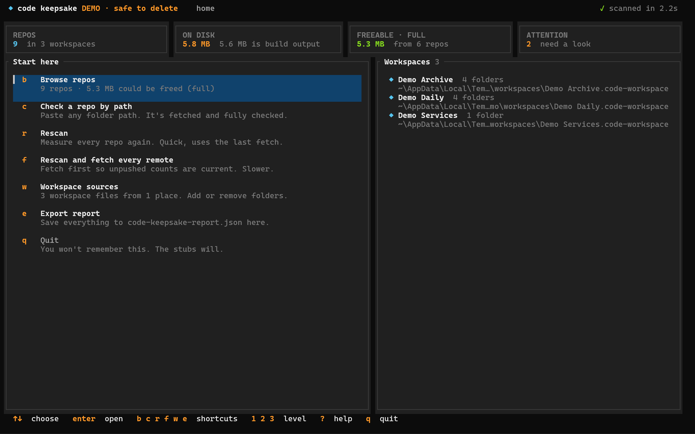
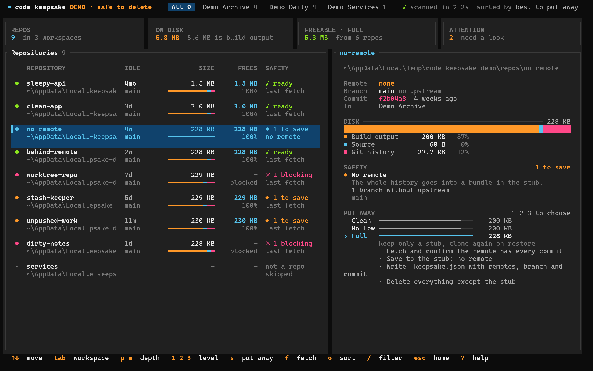
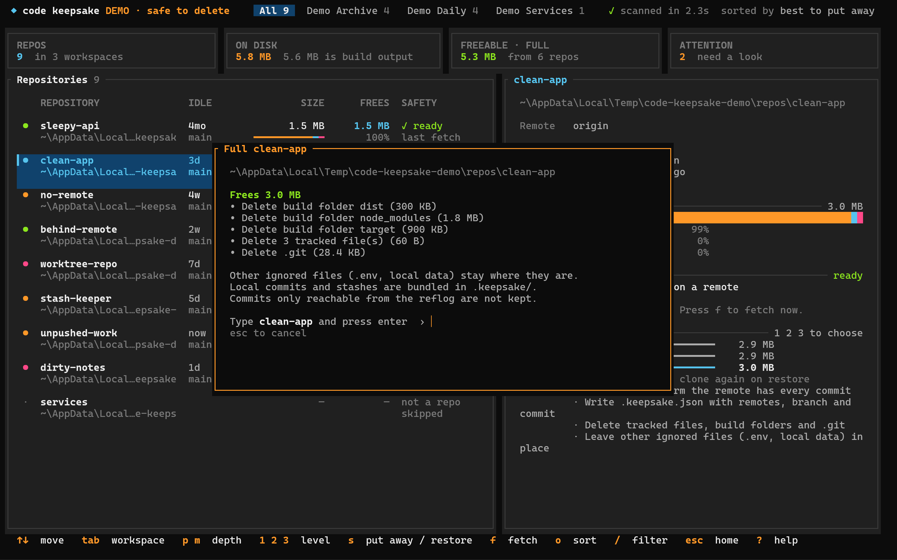

# Code Keepsake

*For developers with short-term memory loss about their own repos.*

<table>
  <tr>
    <td width="33%"><a href="docs/images/launch-screen.png"></a></td>
    <td width="33%"><a href="docs/images/repo-view.png"></a></td>
    <td width="33%"><a href="docs/images/clean-app.png"></a></td>
  </tr>
  <tr>
    <td align="center"><sub>Start here</sub></td>
    <td align="center"><sub>Browse your repos</sub></td>
    <td align="center"><sub>See it before it happens</sub></td>
  </tr>
</table>

You have a condition. You can't form new memories about which remote that old Tauri experiment was pushed to. You know who you are. You know you had a branch called `spike`. But since the repo left your disk, everything's fuzzy.

Code Keepsake doesn't fix your memory. It does what Leonard Shelby did: it leaves notes everywhere, and it never trusts anyone, least of all you.

It finds the repos in your VS Code workspaces, shows what each one is costing you, puts the quiet ones away, and brings them back when you ask.

> **Status:** scanning, putting away and restoring all work from the interactive view. It deletes real files, so [try it on the demo](#5-try-it-safely) first.

---

## 6. How it works (told backwards, obviously)

Memento tells its story in reverse, so this README counts down too. You start at the end.

**The end:** the folder is still in your workspace, just much lighter. Inside is `.keepsake.json`, plus any ignored files that were never Code Keepsake's to delete.

**Just before that:** Code Keepsake removed only what can be brought back: tracked files, ignored build folders and, for a Full, `.git`.

**Before that:** it wrote `.keepsake.json`. It's the Polaroid with handwriting on the back. It records the remotes, the branch, the commit, the level and when. For a Full, anything that existed only on your machine got tattooed into a `.keepsake/` folder beside it: unpushed commits and every stash in a bundle, along with your git config and hooks. Facts, not memories.

**Before that:** it showed you exactly what would be deleted, and waited.

**Before that:** it checked everything. Uncommitted changes. Unpushed commits. Stashes. Extra worktrees. Repos hiding inside repos. For a Full it fetched first, because the remote-tracking refs on your disk are just memories, and memories can be changed and distorted.

**The beginning:** you opened Code Keepsake and it read your `.code-workspace` files. That's the wall of photos and string. It's the only map it trusts.

## 5. Try it safely

Don't trust a stranger with your folders. Make it prove itself on some that don't matter.

On the launch page, press `d` for **Try the demo**. Inside it, `d` takes you back to your own repos and `x` rebuilds the demo from scratch.

Or from a terminal (after [installing](#4-run-it)):

```powershell
code-keepsake demo           # build the demo repos (if needed) and open them
code-keepsake demo --reset   # start over with fresh ones
code-keepsake demo --clean   # delete them
```

(From the source folder: `cargo run --release -- demo`.)

The demo creates real git repos, real (local) remotes and three workspace files in your temp folder, under `code-keepsake-demo`. It works offline, keeps its settings in memory so your real ones are never touched, and says `DEMO · safe to delete` at the top. Removal in the demo is real removal, on repos made to be removed. Only repos inside the demo folder can be put away there.

| Repo | What's going on | What to expect |
|---|---|---|
| `clean-app`, `sleepy-api` | Pushed, with build folders | Every level works |
| `behind-remote` | The remote has a newer commit | Press `f` to see it |
| `unpushed-work` | Two commits that exist only here | A Full bundles them |
| `stash-keeper` | Has a stash | A Full bundles it |
| `no-remote` | No remote at all | A Full bundles the whole history |
| `dirty-notes` | Uncommitted and untracked changes | Hollow and Full are blocked |
| `worktree-repo` | A second worktree elsewhere | Hollow and Full are blocked |
| `services/` | Three repos inside one folder | On the **Demo Services** tab, press `p` |

## 4. Run it

You need [Rust](https://rustup.rs) to build it, and `git` on your PATH.

```powershell
git clone https://github.com/phbronson999/Code-Keepsake.git
cd Code-Keepsake
cargo install --path crates/code-keepsake
code-keepsake
```

`cargo install` puts the `code-keepsake` command in Cargo's `bin` folder, which rustup adds to your PATH. It's a copy, and it has no memory of what happened after it was made: after pulling new changes, run the install again.

| Command | What it does |
|---|---|
| `cargo install --path crates/code-keepsake` | Builds and installs (or updates) the `code-keepsake` command |
| `cargo run --release` | Builds and runs from the source folder. Installs nothing. |
| `cargo uninstall code-keepsake` | Removes the command |

It opens on the launch page and starts scanning right away. Everything there has a single-letter shortcut, so even if you forget the letters you can still arrow down and press enter:

| Key | Option | What it does |
|---|---|---|
| `b` | **Browse repos** | The wall of Polaroids: every repo ranked by how much you'd gain from putting it away |
| `c` | **Check a repo by path** | Paste any folder path (quotes from "Copy as path" are fine). It's fetched and fully checked. |
| `r` | **Rescan** | Measure everything again, using the last fetch |
| `f` | **Rescan and fetch every remote** | Same, but check the facts against the remotes first. Slower, more trustworthy. |
| `w` | **Workspace sources** | The folders to search for `.code-workspace` files. Set them once and they're saved, like a tattoo, minus the regret. |
| `e` | **Export report** | Writes `code-keepsake-report.json` to the current folder, for scripts that also can't remember anything |
| `d` | **Try the demo** | Throwaway repos for [trying it safely](#5-try-it-safely) |
| `q` | **Quit** | You won't remember this. The stubs will. |

### The repo browser

| Key | What it does |
|---|---|
| `↑` `↓` (`j` `k`) | Move. The list loops. `PgUp` `PgDn` `g` `G` jump. |
| `tab` | Next workspace |
| `1` `2` `3` | Choose Clean, Hollow or Full |
| `s` or `enter` | Put the repo away, or restore one that already is |
| `e` | Open the repo's folder |
| `p` `m` | Look deeper or shallower for repos on this workspace tab |
| `f` | Fetch this repo and check it again |
| `r` | Rescan |
| `o` | Change the sort order |
| `/` | Filter |

Press `?` on any screen to see its keys, and `esc` to go back.

### Folders full of repos

A workspace folder is normally one repo. If yours holds many, open that workspace's tab and press `p` to search a level deeper (up to 6), or `m` to come back. The tab shows the current depth, and each workspace remembers its own.

### Settings

Until you add a workspace source, Code Keepsake searches the folder you launched it from. Sources and depths are saved in `%APPDATA%\code-keepsake\config.json` (or `~/.config/code-keepsake/` elsewhere).

## 3. Levels

How much do you want to forget?

| Key | Level | Deletes | Restoring | Memento equivalent |
|---|---|---|---|---|
| `1` | **Clean** | Ignored build folders (`target/`, `node_modules/`, `dist/`, …). The repo stays usable. | Nothing to restore | Throwing out the motel receipts. You were never going to read them. |
| `2` | **Hollow** | Build folders and tracked files. Keeps `.git`. | Offline | The memories are gone but the tattoos stay. |
| `3` | **Full** | Build folders, tracked files and `.git`. | Needs the remote, if the repo has one | A single Polaroid with an address on the back. |

Nothing happens without a preview. Clean then asks for `y`; Hollow and Full ask you to type the repo's name.

**What stays.** Ignored files that aren't build output (`.env`, keys, local databases, logs) are left exactly where they are. They aren't copied or zipped, so deleting the folder yourself afterwards would still lose them.

**Getting it back.** Press `s` on a put-away repo. Existing files are never overwritten. Build folders aren't recreated; your build tools do that.

**What a Full forgets.** Commits reachable only through the reflog, such as ones discarded by a hard reset, are not kept.

## 2. Safety checks

Every repo gets one of three verdicts.

- **✓ ready.** Nothing found that exists only here, as of the last fetch.
- **◆ N to save.** Some things exist only on this machine: unpushed commits, stashes, no remote, hooks, important ignored files. Hollow keeps `.git`, a Full bundles the git history it needs, and ignored files stay put.
- **✕ blocking.** Hollow and Full won't touch it until you deal with this. Don't make decisions based on a note you haven't finished writing.

Hollow and Full are refused for:

- uncommitted or untracked changes
- other worktrees using the repo, or a folder that is itself a worktree or submodule checkout
- submodules, or another repo nested inside
- files marked assume-unchanged or skip-worktree
- a repo with no commits

A Full is also refused if the fetch fails, if there are Git LFS objects, or if an annotated tag is on no remote. Some of these only show up in the preview, which checks harder than the list does.

Clean only deletes ignored build folders, so these don't stop it.

Unpushed counts are compared with the last fetch, and the last fetch is a memory. Press `f` on a repo, or pick **Rescan and fetch** on the launch page, to check the facts against the remote right now.

### Remember Sammy Jankis

Sammy was a developer. He had a repo with three stashes, an unpushed branch called `actually-working`, and a `.env` with the only copy of a production API key. He deleted the folder to free up 9 GB because "it's all on GitHub anyway."

It was not all on GitHub.

Sammy now runs `git stash list` every morning in an empty folder, hoping something comes back. Code Keepsake exists so you never become Sammy.

## 1. Layout

```
crates/
  keepsake-core/   no UI: workspaces, git, sizes, safety, plans, putting away and restoring, demo repos
  code-keepsake/   the binary: the ratatui TUI
tests-std/         the std-only core modules compiled alone, for tests with nothing but rustc
```

`keepsake-core` has no UI code, so a GUI can sit on top of it later, once you remember you wanted one.

## 0. Tests

You can't trust your memory, so test.

```powershell
cargo test --workspace
```

The tests build throwaway repos in your temp folder and put them away for real, so they take about a minute.

The std-only modules (JSONC parsing, git output parsing, size measurement, formatting) can also be tested with nothing but `rustc`:

```powershell
cd tests-std
rustc --edition 2021 --test harness.rs -o harness; ./harness
```

If a test fails, write it down. On the back of a Polaroid if you have to.
